## Praktikum 7 : Pemograman Server-Side dengan PHP ##

Pada praktikum 7, saya akan menjelaskan beberapa latihan dan mini projek. Selain itu, saya juga akan menjelaskan eksperiment mandiri.

## Latihan 1 : Menjalankan PHP

Membuat file dalam tipe .php lalu memasukkan kode. Cara menjalankannya, kita menggunakan xampp. Start di apk xampp bagian apache, lalu kita salin alamat filenya ke chrome, nanti akan muncul hasilnya di chrome.

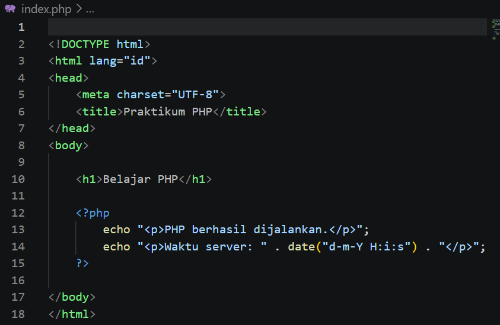
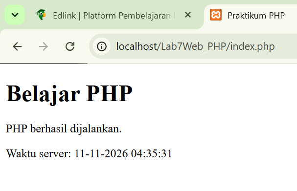

## Latihan 2 : Variabel, operator dan percabangan

$nama, $tugas, $uts, $uas adalah variabel. 0.30 berarti bobot nilai 30% dan 0.40 berarti bobot nilai 40%. if dan elseif digunakan untuk menentukan predikat berdasarkan nilai akhir.number_format() digunakan untuk menampilkan dua angka di belakang koma.

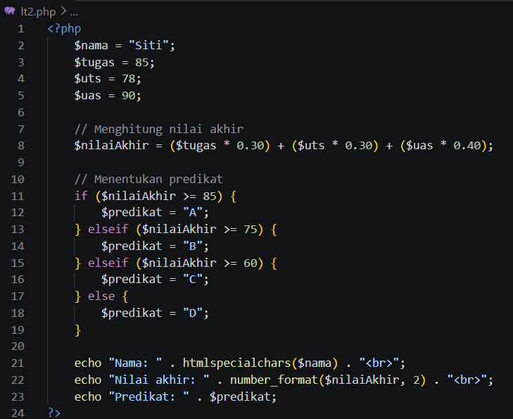
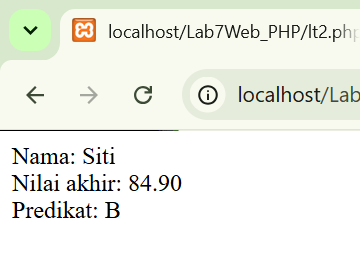

## Latihan 3 : Pengulangan dan array

$mahasiswa adalah array yang menyimpan beberapa nama mahasiswa. foreach digunakan untuk mengambil setiap nama secara bergantian. $nama menyimpan nama yang sedang diproses. < li > membuat daftar bernomor. htmlspecialchars() membantu mengamankan teks sebelum ditampilkan. 

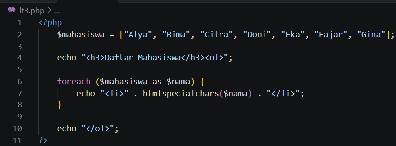
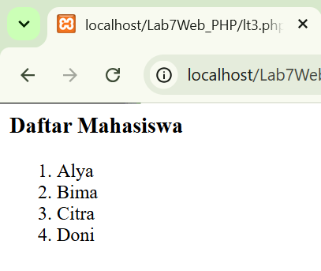
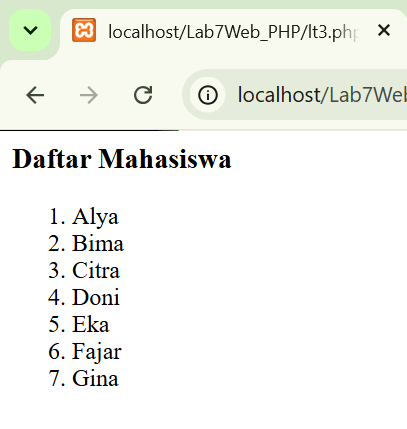

## Latihan 4 : Membuat function

function hitungDiskon() adalah fungsi untuk menghitung diskon.$harga adalah harga barang. $persen adalah persentase diskon.$potongan adalah jumlah uang yang dikurangi. return mengembalikan hasil perhitungan. number_format() membuat angka tampil dengan format Rupiah.

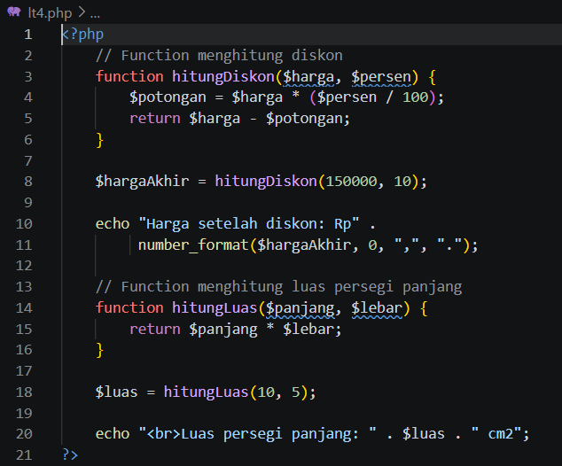
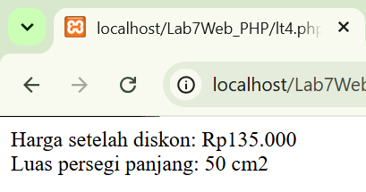

## Latihan 5 : Memproses form dengan GET

Form pencarian berhasil ditampilkan. Kata kunci pemograman web berhasil dikirim. PHP berhasil mengambil data menggunakan $_GET. Kata kunci berhasil ditampilkan kembali di halaman. URL berubah dan memuat parameter kata=pemograman+web.

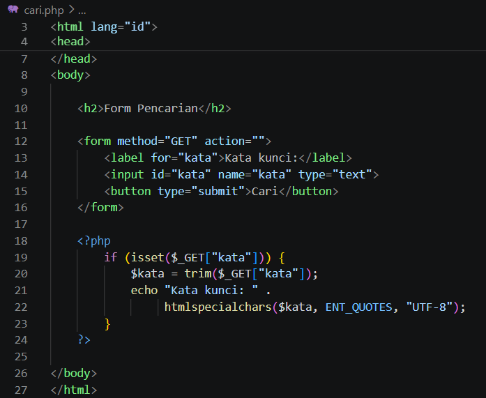
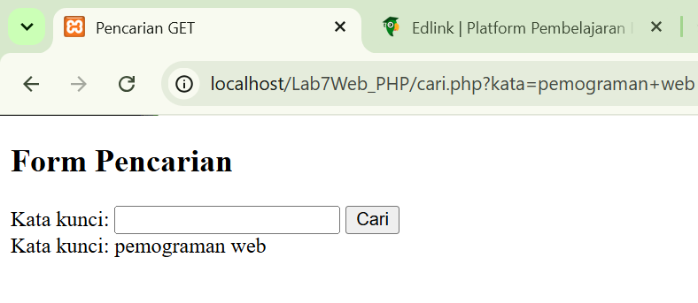

## Latihan 6 : Memproses form dengan POST

Dengan post, hasil pencarian tidak berubah seperti get. Yang ditampilkan hanya pengisian formnya. 

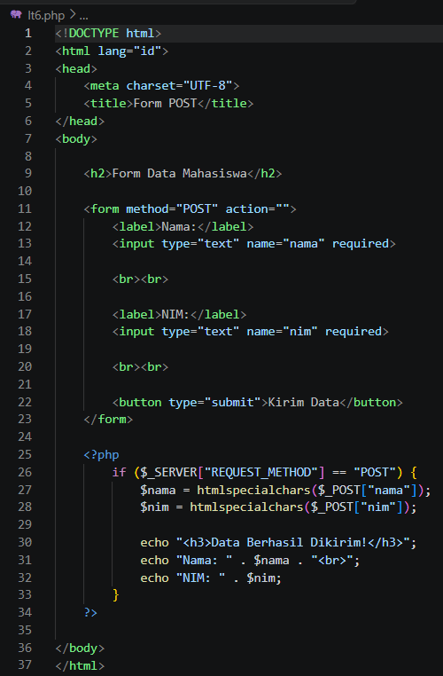
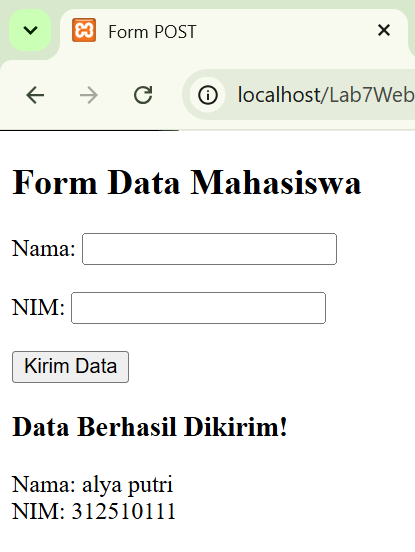

## Latihan 7 : Pengolahan data sederhana

Di latihan ini saya membuat program transaksi barang sederhana. Memasukkan nama barang, memasukkan harga barang,memasukkan jumlah barang, menghitung subtotal secara otomatis,menampilkan ringkasan transaksi, dan memeriksa apakah data yang dimasukkan valid.

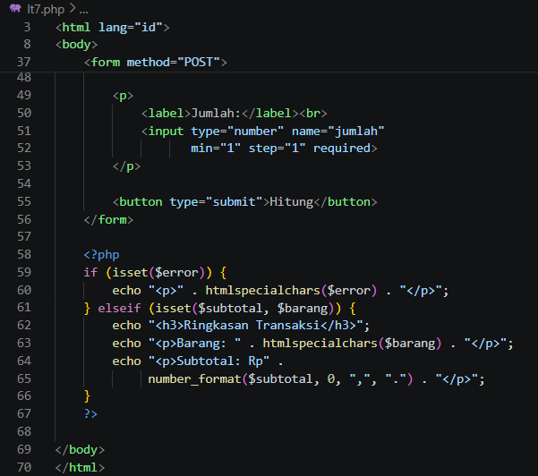
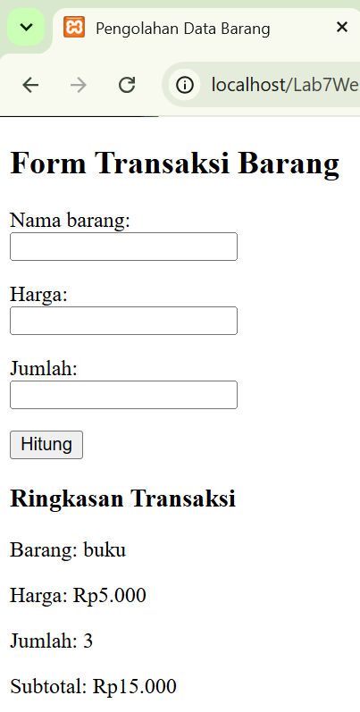
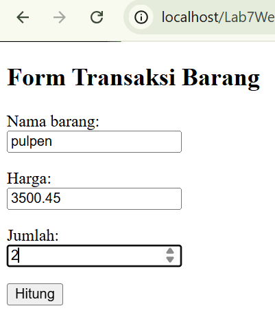
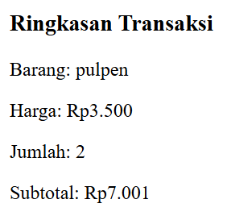
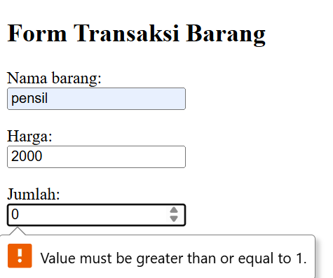
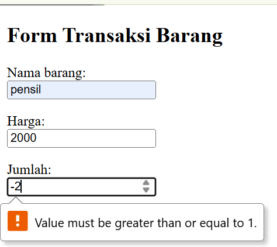

## Mini project

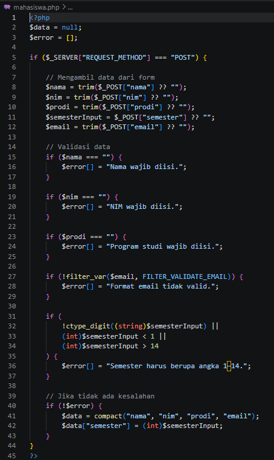
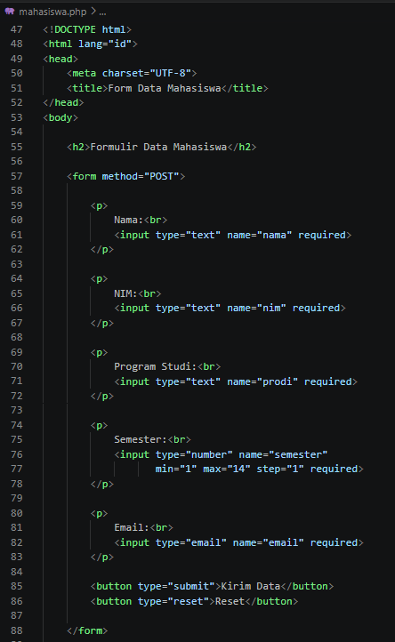
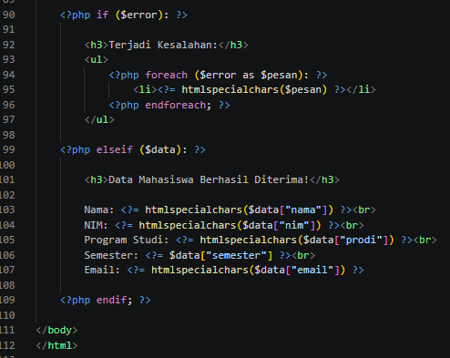
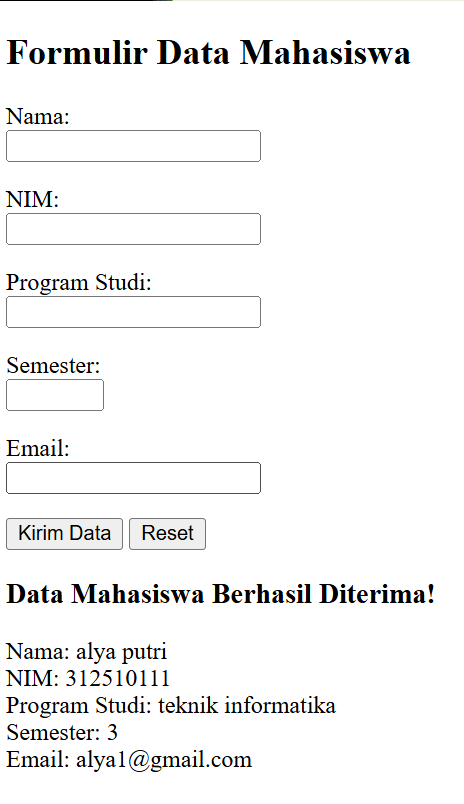
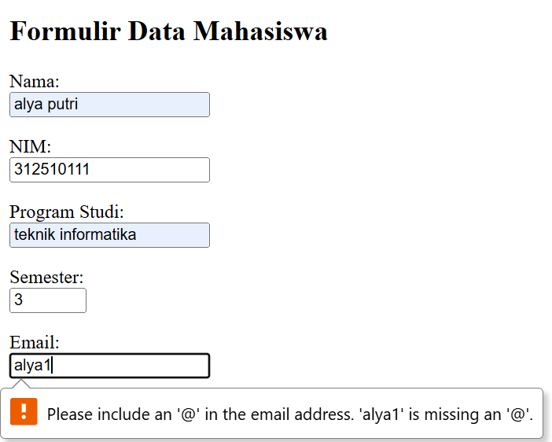
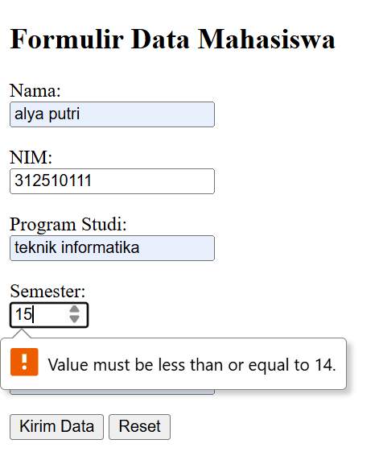
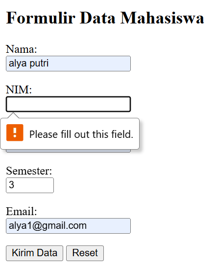

## Eksperimen mandiri 

1. Menghitung nilai rata-rata

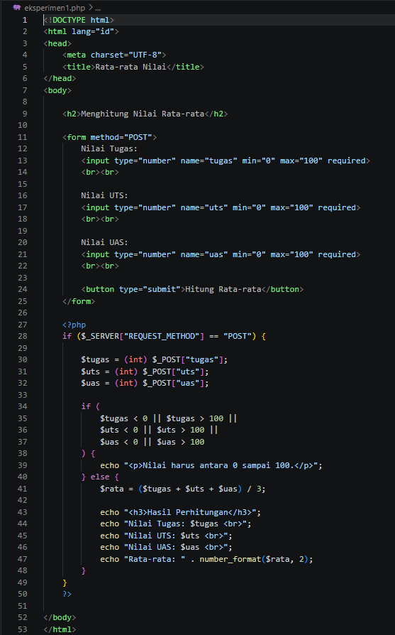
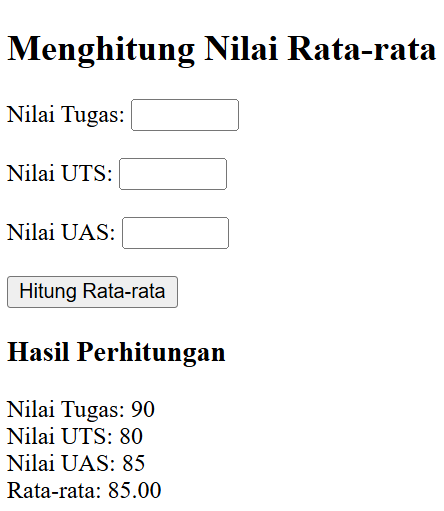

2. Pencarian nama menggunakan get

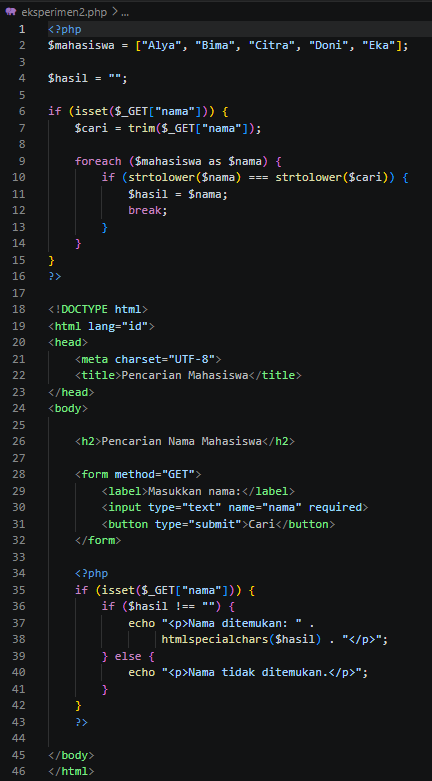
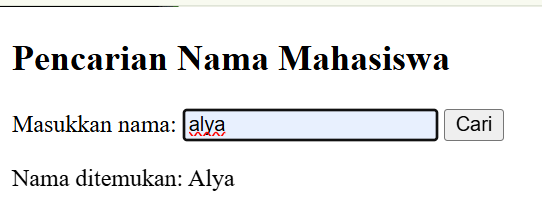
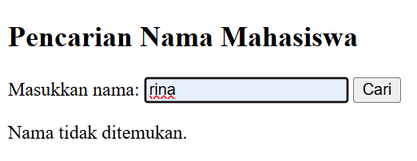

3. Membuat function untuk mengubah format harga menjadi Rupiah

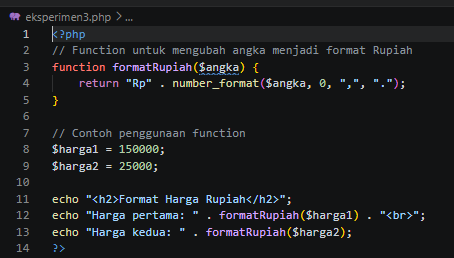
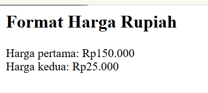

4. Menambahkan validasi NIM hanya berisi angka dan panjangnya sesuai ketentuan

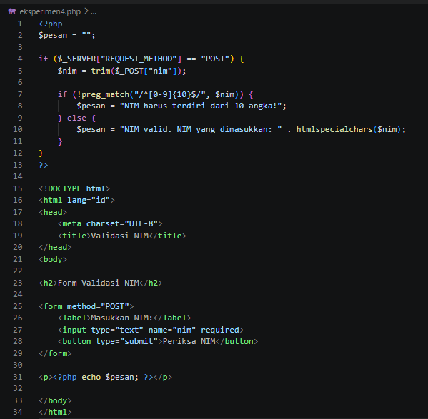
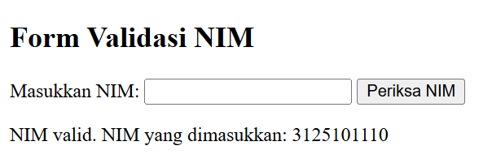
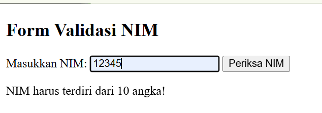
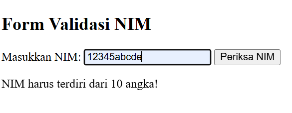

5. Menambahkan tombol Reset pada Form

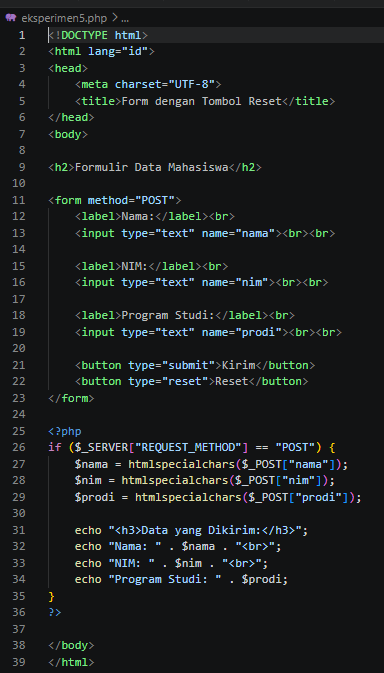
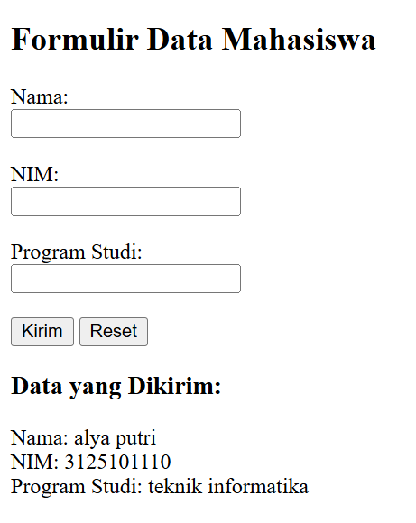
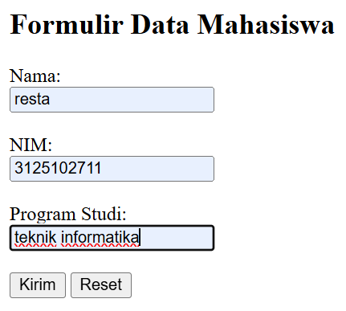
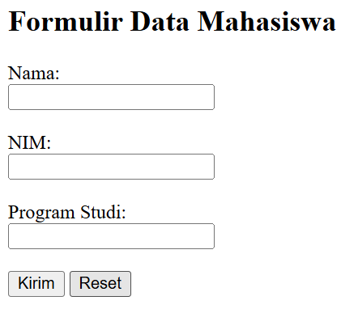

## Pertanyaan Evaluasi

1. Apa perbedaan pemrosesan client-side dan server-side?

Jawaban:

Client-side adalah pemrosesan data yang dilakukan di sisi pengguna melalui browser, biasanya menggunakan JavaScript. Server-side adalah pemrosesan data yang dilakukan di server menggunakan bahasa pemrograman seperti PHP. Hasil pemrosesan server kemudian dikirimkan kembali ke browser.

2. Mengapa file PHP harus dijalankan melalui web server?

Jawaban:

Karena PHP merupakan bahasa pemrograman server-side yang membutuhkan web server untuk menjalankan dan memproses kode PHP. Jika file PHP dibuka langsung melalui folder komputer, kode PHP tidak akan diproses dengan benar.

3. Apa fungsi tanda $ pada variabel PHP?

Jawaban:

Tanda $ digunakan untuk mendefinisikan variabel dalam PHP. Variabel berfungsi untuk menyimpan data yang dapat digunakan dan diolah dalam program.

Contoh: $nama = "Alya";

4. Apa perbedaan metode GET dan POST?

Jawaban:

GET mengirimkan data melalui URL sehingga data dapat terlihat pada alamat browser. Sedangkan POST mengirimkan data melalui bagian isi permintaan (request body), sehingga data tidak ditampilkan langsung pada URL.

5. Mengapa input pengguna perlu divalidasi di sisi server?

Jawaban:

Validasi server diperlukan untuk memastikan data yang dikirim pengguna sesuai dengan ketentuan program. Validasi juga membantu mencegah data kosong, format yang salah, dan input yang tidak sesuai.

6. Apa fungsi htmlspecialchars() ketika menampilkan data dari form?

Jawaban:

htmlspecialchars() digunakan untuk mengubah karakter khusus HTML menjadi bentuk yang aman saat ditampilkan. Fungsinya membantu mencegah input pengguna dianggap sebagai kode HTML atau JavaScript yang berbahaya.

7. Apa manfaat penggunaan function dalam program PHP?

Jawaban:

Function bermanfaat untuk mengelompokkan kode berdasarkan tugas tertentu agar program lebih rapi, mudah digunakan kembali, dan tidak perlu menulis kode yang sama berulang kali.